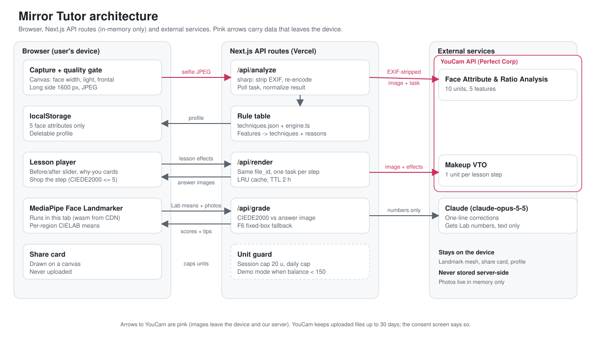
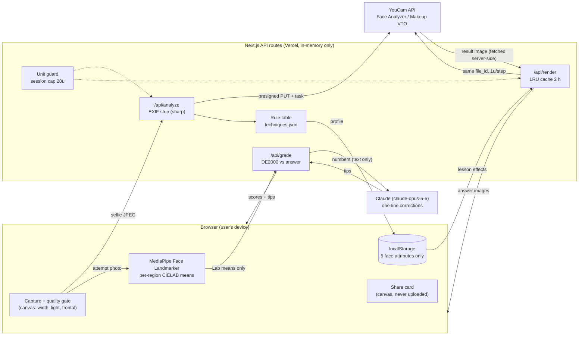

# Mirror Tutor

**Mirror Tutor teaches makeup on your own face.** YouCam Face Analyzer reads your features, a hand-written rule table picks the technique for them, YouCam Makeup VTO renders every lesson step on your photo as the answer key, and you grade your real attempt against it.

Entry to the Perfect Corp **YouCam API VTO Hackathon** (track: eCommerce VTO).
Live demo: https://mirror-tutor.vercel.app (see [Demo mode](#demo-mode-and-unit-guard)).

**Why this is not a wrapper**
- Face Analyzer output feeds a rule table (`lib/rules`): monolid and double-lid faces get different techniques.
- Lesson step k renders effects 1..k cumulatively on one uploaded `file_id` with Makeup VTO.
- The VTO output is the CIEDE2000 grading reference for your real attempt.
- The foundation shade measured on the device is passed into the VTO foundation effect.

## Problem

Makeup tutorials are filmed on someone else's face. The same eyeshadow looks different on a monolid, an inner-double or a double eyelid, yet the video never says what to change for you. After you try, nothing tells you how close you got, and the products in the video are a separate search.

## Solution

1. **Capture** a selfie with a live quality gate (face width at least 60% of the frame, enough light, frontal, zoom) so the YouCam input requirements are met before any unit is spent.
2. **Analyze** with YouCam Face Attribute & Ratio Analysis: eyelid, eye shape, lip shape, face shape, brow shape. You can correct any value. In parallel the browser measures cheek skin tone on MediaPipe landmarks (0 units) and picks a foundation shade from a 6-step ladder (13N to 27W, `lib/skin/shades.json`); you can override it.
3. **Pick techniques** from a rule table (`lib/rules/techniques.json`, `lib/rules/engine.ts`), for example monolid -> horizontal gradient shadow + liner visible 1.5 mm. Every step shows a "why you" reason.
4. **Learn** with 3 lessons x 4 steps. YouCam Makeup VTO renders each step cumulatively on your photo (before/after slider).
5. **Grade** your own attempt photo: per-region score (eye line, eyelid, cheek, lip) plus a one-line correction.
6. **Shop the step**: the hex colors used in a step are matched to a demo catalog by color difference (CIEDE2000 <= 5). Then a share card.
7. **/compare**: a monolid face and a double-lid face (pre-generated with real YouCam calls) get the same look; the page opens on the eye step where their techniques split. The monolid face's eyelid was corrected on M2 after Face Analyzer read it as a double lid, and the page says so. A what-if panel previews the other rule-table branches (inner double, hooded, lip shapes) as text for 0 units.
8. **/partner**: the retailer view (concept): the lesson widget on a fictional product page, an illustrative one-line integration snippet (no SDK is published), the unit-cost meter (14 then 4) and the KPIs to measure, all marked as hypothesis with no numbers.
9. **Home**: returning users see a practice streak, past results and a bottom tab bar; all of it is stored on the device only. "View in store" in Shop the step opens a confirmation sheet before leaving the app.

## YouCam APIs used

Server `https://yce-api-01.makeupar.com`, `Authorization: Bearer <API key>`. Details, doc-vs-server corrections and live spike results: [docs/api-notes.md](docs/api-notes.md).

| Purpose | Endpoint | Units |
|---|---|---|
| Upload (presigned PUT) | `POST /s2s/v2.0/file` | no SKU in `feature-cost`; not counted by our unit guard |
| Face Attribute & Ratio Analysis (5 features) | `POST /s2s/v2.0/task/face-attr-analysis` | 10 per call (1-5 features tier; 6-14 = 20, 15-28 = 30) |
| Makeup VTO (one lesson step) | `POST /s2s/v2.0/task/makeup-vto` | 1 per step |
| Task polling | `GET /s2s/v2.0/task/{feature}/{task_id}` | 0 |
| Balance | `GET /s2s/v1.0/client/credit` | 0 |
| Unit prices | `GET /s2s/v2.0/credit/feature-cost` | 0 |

Unit budget: one first-time flow is 10 (analysis) + 4 (one lesson) = **14 units**. Re-grading, shopping, sharing and the compare page cost 0. Returning users reuse the on-device profile, so only the 4 VTO units apply.

The Makeup VTO effects used: `skin_smooth`, `foundation`, `eyebrows`, `eye_shadow`, `eye_liner`, `blush`, `contour`, `lip_color` (see `lib/lessons/*.json`).

## Architecture





What leaves the device:

- Selfie (EXIF stripped on the server) -> our API route -> YouCam (Face Analyzer, Makeup VTO). YouCam keeps uploaded files for up to 30 days, and the consent screen says so.
- Skin tone is measured in the browser on the capture photo; only the chosen shade id (e.g. `23N`) is sent to `/api/render`, never the measured color or landmarks.
- Landmark mesh and pixels of the attempt photo are processed in the browser. The server receives the answer and attempt images (in memory, to sanitize and compute color differences) and 4 region Lab means. In the normal path Claude gets only those numbers (text-only call). If MediaPipe cannot run, the F6 fallback sends fixed-box region crops to Claude vision, or grades locally with no Claude call when no key is set.
- Share card is drawn on a client canvas and is never uploaded.

## Run locally

```bash
npm install
cp .env.example .env      # optional: fill keys; empty = mock mode
npm run dev               # http://localhost:3000
```

`.env.example` keys (names only): `YOUCAM_API_KEY`, `YOUCAM_SECRET_KEY` (only for the V1 balance endpoint), `YOUCAM_MODE` (`mock` | `live`), `ANTHROPIC_API_KEY`, `GRADER_MODEL`, `SESSION_UNIT_CAP`, `DAILY_UNIT_CAP`, `DEMO_MODE_THRESHOLD`, `MOCK_CREDIT`, and the `SPIKE_*` variables for the spike scripts.

Without `YOUCAM_API_KEY` the app runs in **mock mode**: no YouCam call, no units, a local overlay renderer fitted to MediaPipe eye and mouth anchors. Without `ANTHROPIC_API_KEY`, corrections come from rules instead of Claude.

Other commands:

```bash
npm run typecheck && npm run lint
npm run spike -- all      # real-API spikes (needs YOUCAM_API_KEY + .local/face.jpg, unit-capped at SPIKE_MAX_UNITS, default 55)
npm run catalog:fetch     # refresh the public VTO pattern catalog (0 units)
npm run i18n:review       # one Claude call reviewing ko/en copy
YOUCAM_MODE=live npx tsx scripts/demo/generate.ts   # pre-generate public/demo/model-*/ (resumable)
```

## Tests

```bash
npm test    # vitest: unit + integration (tests/), no network, no units (201 tests in 27 files)
```

Covers the rule table and lesson labels against the real pattern catalog, quality gate, unit guard, request builders against recorded live response bodies, privacy sanitizing, grading, shop matching, share card layout, i18n and an end-to-end core flow on the mock transport.

## Deploy

Vercel (region `icn1`, see `vercel.json`):

```bash
npx vercel link --yes
bash scripts/vercel-env.sh     # pushes env vars from .env without printing values
npx vercel --prod --yes
```

`.vercelignore` keeps `.env*` and `.local/` out of uploads. To go live, set `YOUCAM_MODE=live` with the YouCam and Anthropic keys and redeploy. A deploy from a git checkout can be blocked if the last commit author is not a Vercel team member; deploy from a copy without `.git` or add the author to the team.

## Demo mode and unit guard

- Per-session cap of 20 units (default `SESSION_UNIT_CAP`) and a global daily cap (default `DAILY_UNIT_CAP`=120). Units are reserved before a task starts and released on error.
- If the remaining balance is below `DEMO_MODE_THRESHOLD` (default 150), the app serves the pre-generated sample models in `public/demo/` instead of calling YouCam.
- Remaining balance is cached for 5 minutes. State is in process memory, so on serverless the caps are per instance (best effort).
- Test inputs: `public/demo/model-a`, `model-b` (stock photos, Pexels License), `model-c` (monolid, Unsplash License; see its SOURCE.md); all sample faces are Pexels and Unsplash License stock photos or your own selfie.

## Privacy principles

1. Original and result images are never written to disk or a database, and never logged.
2. EXIF (GPS, device, timestamps) is stripped on the server by re-encoding.
3. Images go to YouCam by presigned PUT; YouCam result URLs are fetched server-side and not exposed to the browser.
4. The consent screen states that YouCam keeps uploaded files up to 30 days.
5. `localStorage` holds only the 5 face attributes, with a "delete profile" button; ending a session discards results.
6. The share card is rendered on the device, with face blur on by default.
7. Videos and screenshots use only the author's face or a consenting or stock-licensed model.
8. No keys in the repository (`.env.example` has names only).

## Limitations

- **Grading error**: scores depend on lighting, angle and framing. The grader reports a confidence level and lowers it when the two photos are not comparable. Landmark polygon boundaries were checked against standard mesh indices, not exhaustively on real faces. It is a practice aid, not a measurement.
- **Demo catalog is fictional**: 17 "MT Select" SKUs (one cushion per foundation ladder shade) with demo prices and stock. Real SKUs would be replaced by a partner product feed. No checkout is implemented.
- **Only the base color is personalized**: foundation shade (and blush intensity) follow the measured skin tone; eye and lip colors are fixed per lesson. The skin measurement is approximate (camera white balance, room light); the app shows a low-confidence hint when the cheeks disagree or the photo is very dark/bright, keeps the lesson default when detection fails, and demo mode keeps the default.
- **Mock mode overlay is approximate**: it is a local drawing fitted to eye and mouth anchors, not YouCam output. Real results appear in live mode and on `/compare`.
- Rule-table techniques are hand-written; the YouCam analysis only selects among them. `inner_double` is a user choice in the correction sheet, not an API value.
- VTO pattern shapes were verified against API acceptance and the pattern catalog; whether each pattern renders exactly as described is judged by eye.

## Docs

- [docs/api-notes.md](docs/api-notes.md): real endpoints, unit costs, spike results
- [docs/plan.md](docs/plan.md): plan (Korean)
- [docs/design.md](docs/design.md): design tokens

## License

[MIT](LICENSE)
